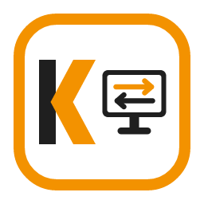

<p align="center">
  
</p>

<h1 align="center">Kronos Remote Support</h1>

<p align="center">
  App di assistenza remota multipiattaforma in stile TeamViewer, scritta in Rust.<br>
  macOS · Windows · Linux
</p>

---

> **Stato: prototipo in sviluppo.** L'app collega due computer tramite ID e password, con conferma
> dell'utente remoto, mostra lo schermo del partner e permette di controllarne mouse e tastiera, tra macOS,
> Windows e Linux (sessione Xorg; Wayland non ancora supportato).

## Come funziona

Ogni installazione riceve un **ID di 9 cifre** e mostra una **password** di 8 caratteri (lettere minuscole e cifre).
Chi vuole connettersi inserisce ID e password del partner; il partner vede un **popup di conferma** e decide se consentire.

```
  Viewer (chi controlla)                                      Host (chi viene controllato)
 ┌──────────────────────┐        WSS        ┌───────────┐       WSS        ┌──────────────────────┐
 │ Kronos Remote Support│ ◀───────────────▶ │ Signaling │ ◀──────────────▶ │ Kronos Remote Support│
 └──────────┬───────────┘   (solo contatto) │  server   │                  └───────────┬──────────┘
            │                               └───────────┘                              │
            └────────────── WebRTC peer-to-peer cifrato (DTLS) ────────────────────────┘
                     password verificata qui con SPAKE2, mai inviata
```

- Il **server di signaling** assegna gli ID e mette in contatto i due computer. Non vede mai schermo, input o password.
- La connessione tra i due computer è **diretta e cifrata** (WebRTC). Dove la rete non lo consente servirà un relay TURN (in arrivo).
- La **password non lascia mai il dispositivo**: viene verificata con il protocollo SPAKE2, legato ai certificati
  della connessione. Un server malevolo non può né leggerla né fingersi l'altro computer.
- Dopo 5 password errate in 10 minuti l'host rifiuta nuovi tentativi per un po'.

## Download

Gli installer sono pubblicati nelle **[release di KronosHub/Kronos-Remote-Support](https://github.com/KronosHub/Kronos-Remote-Support/releases/latest)**
(macOS Apple Silicon/Intel, Windows `.exe`/`.msi`, Linux `.AppImage`/`.deb`/`.rpm`).
Dalla 0.6.0 l'app si aggiorna da sola con il pulsante **Aggiornamenti** (pacchetti firmati).

Gli installer non sono ancora firmati:
- **macOS**: al primo avvio clic destro sull'app → *Apri*.
- **Windows**: nella schermata SmartScreen → *Ulteriori informazioni* → *Esegui comunque*.

## Uso

1. Avvia **Kronos Remote Support** su entrambi i computer.
2. Sul computer da controllare leggi **ID** e **password** (riquadro *Consenti il controllo*).
3. Sull'altro computer inseriscili in *Controlla un computer remoto* e premi **Connetti**.
4. Sul computer remoto compare la richiesta: **Consenti** o **Rifiuta** (rifiuto automatico dopo 30 secondi).
5. Si apre lo schermo del partner (pulsanti *Schermo intero* e *Disconnetti*). Chi condivide vede un banner rosso
   con il pulsante **Termina**.

Permessi necessari sul computer controllato:
- **macOS**: *Registrazione schermo* (per farsi vedere) e *Accessibilità* (per farsi controllare), in
  Impostazioni di Sistema → Privacy e sicurezza. L'app li chiede alla prima connessione.
- **Linux**: sessione **Xorg** (dalla schermata di login, es. "Ubuntu su Xorg").
- **Windows**: nessuno; le finestre avviate come amministratore e le richieste UAC non sono controllabili.

Nella barra del viewer, *Controllo attivo/spento* abilita l'invio di mouse e tastiera; i tasti sono inviati per
posizione fisica (vale il layout del computer controllato).

### Accesso non presidiato (i tuoi dispositivi)
Sul computer da controllare: *Consenti il controllo* → **Imposta password personale**, e se vuoi **Avvia all'accesso**.
Dall'altro computer inserisci ID e password personale con la casella **Password personale (senza conferma)**,
eventualmente **Salva come**: il dispositivo comparirà in **I miei dispositivi** e si apre con un clic, senza popup.
La password personale non viene mai salvata né trasmessa (resta solo un segreto derivato, verifica SPAKE2).

Chiudendo la finestra l'app resta attiva nell'icona della barra di sistema, così può ancora ricevere richieste.
Per uscire: icona → *Esci* (su macOS anche ⌘Q).

## Sviluppo

### Requisiti
- [Rust](https://rustup.rs) stabile
- Node.js LTS (frontend dell'app)
- macOS: Xcode command line tools · Linux: `libwebkit2gtk-4.1-dev libayatana-appindicator3-dev librsvg2-dev`

### Comandi principali
```bash
# test e controlli
cargo test --workspace
cargo clippy --workspace --all-targets
./scripts/e2e-local.sh                  # server + due peer in locale, password giusta/sbagliata

# app desktop
cd apps/desktop && npm install
npx tauri dev                           # sviluppo
npx tauri build                         # installer per il sistema corrente (serve la chiave updater, vedi CLAUDE.md)

# server di signaling in locale
cargo run -p signaling -- --listen 127.0.0.1:8080

# strumenti a riga di comando
cargo run -p peer-poc -- host --source pattern             # mostra ID e password, trasmette un'immagine di prova
cargo run -p peer-poc -- connect 123456789 -p password --save out.h264   # riceve il video, misura fps e latenza
cargo run --release -p capture-poc -- --seconds 10         # cattura schermo → capture.h264 (macOS)
```

### Struttura
| Percorso | Contenuto |
|---|---|
| `apps/desktop` | App Tauri 2 + SvelteKit: interfaccia, servizio in background, icona di sistema |
| `apps/signaling` | Server di signaling (axum + WebSocket) |
| `crates/auth` | Password di sessione, SPAKE2 e conferma della chiave |
| `crates/transport` | Client di signaling, sessioni WebRTC, traccia video, handshake password |
| `crates/stream` | Streaming dello schermo (cattura → H.264 → WebRTC) e logica di sessione |
| `crates/protocol` | Messaggi del canale di controllo |
| `crates/signaling-proto` | Messaggi JSON tra client e server |
| `crates/capture` | Cattura dello schermo (macOS: ScreenCaptureKit) |
| `crates/codec` | Codifica video H.264 (OpenH264) |
| `tools/` | Prototipi a riga di comando (`capture-poc`, `peer-poc`) |
| `deploy/` | Signaling su Cloudflare Workers (`deploy/cloudflare`) e installazione del server su VM Linux (systemd + Caddy, HTTPS automatico) |
| `docs/` | Architettura, roadmap, stato, diario e decisioni (ADR) |

## Server

L'app usa un unico server di signaling: `wss://kronos-signaling.kronos-signaling.workers.dev/ws` (Cloudflare Worker,
[ADR 0035](docs/adr/0035-signaling-cloudflare.md), sorgente in `deploy/cloudflare`).
Per installare il server Rust (`apps/signaling`) su una propria VM vedi [`deploy/README.md`](deploy/README.md).

## Roadmap

- [x] Cattura schermo e codifica H.264 (macOS)
- [x] Server di signaling e connessione WebRTC peer-to-peer
- [x] App con interfaccia, ID, password, conferma, icona di sistema
- [x] Build automatiche per macOS, Windows e Linux
- [x] Streaming dello schermo al viewer (H.264 su WebRTC, decodifica hardware)
- [x] Controllo remoto di mouse e tastiera
- [x] Relay TURN per reti restrittive
- [x] Cattura schermo su Windows e Linux (X11)
- [ ] Linux Wayland, encoder hardware
- [x] Appunti condivisi, trasferimento file, più monitor
- [x] Accesso non presidiato con password personale
- [ ] Installer firmati

Dettagli: [`docs/ROADMAP.md`](docs/ROADMAP.md) · Stato attuale: [`docs/STATO.md`](docs/STATO.md) ·
Architettura: [`docs/ARCHITETTURA.md`](docs/ARCHITETTURA.md) · Decisioni: [`docs/adr/`](docs/adr/)

## Firma del codice

Free code signing provided by [SignPath.io](https://about.signpath.io), certificate by
[SignPath Foundation](https://signpath.org).

Ruoli (code signing policy):
- Committer e revisori: [KronosHub](https://github.com/KronosHub)
- Approvatori delle firme: [KronosHub](https://github.com/KronosHub)

Si firmano solo i file prodotti dal workflow [`release.yml`](.github/workflows/release.yml) di questo repository,
a partire da un tag; ogni firma va approvata a mano.

## Privacy

L'app non raccoglie statistiche né dati di utilizzo. Si collega in rete solo per funzionare:
- al server di signaling, per registrare l'ID del dispositivo e mettere in contatto i due computer
  (ID e indirizzi di rete necessari alla connessione; il server non vede schermo, input, file o chat,
  cifrati da un computer all'altro);
- se la connessione diretta non è possibile, a un relay TURN che inoltra il traffico cifrato;
- nella rete locale annuncia ID e nome del dispositivo (mDNS) per farsi trovare dagli altri computer della stessa rete;
- a GitHub, per controllare se esistono aggiornamenti (all'avvio e dal pulsante **Aggiornamenti**).

Kronos Quick Support non controlla gli aggiornamenti.

## Licenza

[MIT](LICENSE) © 2026 Kronos Informatica
